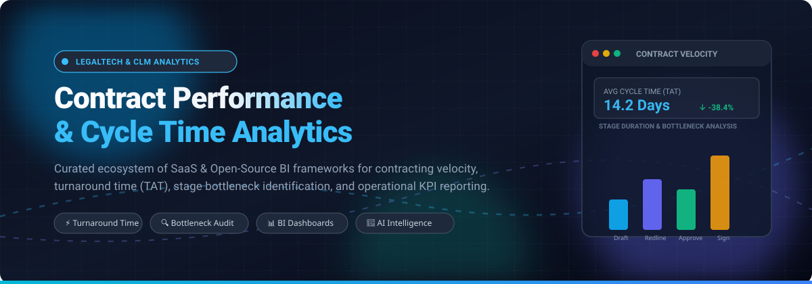

# ⚡ Awesome-Contract-Performance-Cycle-Time-Analytics

  

  
  
  
  
  

---

## 🎯 Top Contract Performance & Cycle Time Analytics Ecosystem

> **A curated directory of enterprise SaaS solutions, contract lifecycle intelligence engines, and open-source business intelligence (BI) data stacks.**  
> *Engineered for tracking contracting velocity, cycle time turnaround (TAT), stage bottleneck identification, approver SLA monitoring, and executive KPI reporting.*

Contract Performance & Cycle Time Analytics empowers legal operations, corporate procurement, revenue operations (RevOps), and sales leadership to quantify every milestone from contract intake, redlining, and executive approval to e-signature execution. Surfacing workflow friction points prevents revenue leakage and accelerates deal closings.

---

## 📑 Table of Contents
- [🌐 Sector Overview & Market Dynamics](#-sector-overview--market-dynamics)
- [🏢 SaaS & Hosted Enterprise Platforms](#-saas--hosted-enterprise-platforms)
- [🔓 Open-Source GitHub Projects & BI Stacks](#-open-source-github-projects--bi-stacks)
- [📈 Star History](#-star-history)
- [🤝 How to Contribute](#-how-to-contribute)
- [💖 Support](#-support)
- [⚖️ Disclaimer](#️-disclaimer)

---

## 🌐 Sector Overview & Market Dynamics

The global Contract Lifecycle Management (CLM) and contract analytics market is estimated at **$1.8B – $3.4B in 2025** and projected to reach **$2.0B – $3.77B by 2026**, expanding at an estimated **CAGR of 11% to 14%**. The market remains **moderately to highly fragmented** across 150+ specialized vendors offering niche legal workflow, AI extraction, and operational analytics tools; however, aggressive consolidation is underway as dominant enterprise incumbents acquire AI-first point solutions to build unified, end-to-end intelligence suites.

---

## 🏢 SaaS & Hosted Enterprise Platforms

Enterprise SaaS and CLM suites evaluated by starting commercial price tier, precise free trial parameters, and company scale (sorted by revenue/valuation descending).

| Product | Company Scale (Valuation / Revenue) | Description | Starting Pricing Tier | Free Tier / Trial Limits |
| :--- | :--- | :--- | :--- | :--- |
| **[Microsoft Power BI](https://powerbi.microsoft.com/)** | **~$3.1 Trillion Market Cap** (Microsoft parent; $245B+ ARR) | Microsoft's enterprise business intelligence platform with desktop visual authoring, cloud collaboration, and prebuilt CLM connectors. Ideal for computing median cycle time and stage turnaround time across enterprise departments. | **$14 / user / month** (Power BI Pro plan, billed annually) | **Free Forever plan**: Power BI Desktop (local authoring, report building, and file export only; cloud sharing restricted); **60-day free trial** for Power BI Pro and Premium Per User |
| **[Looker (Google Cloud)](https://looker.com/)** | **~$2.1 Trillion Market Cap** (Alphabet parent; acquired for $2.6B) | Enterprise BI and data modeling platform using LookML for centralized, governed contract metric definitions. Powers consistent cycle-time KPIs, stage-by-stage redlining tracking, and automated metric bursting. | **$60,000 / year** (~$5,000/month baseline platform fee for Standard edition) *(Looker Studio Pro tier starts at $9/user/month)* | **No free tier**; **30-day free trial** via Google Cloud Sales / GCP Console with $300 Google Cloud evaluation credits |
| **[Tableau](https://www.tableau.com/)** | **~$280 Billion Market Cap** (Salesforce parent; acquired for $15.7B) | Leading visual analytics platform for orchestrating custom contract performance dashboards from extracted CLM data warehouses. Features drag-and-drop workflow cohort analysis, duration trend lines, and approver workload distributions. | **$75 / user / month** (Tableau Creator plan, 1 seat minimum, billed annually at $900/yr); Explorer tier at $42/user/month; Viewer tier at $15/user/month | **Free Forever plan**: Tableau Public (100% free for creating and publishing public visualizations up to 10GB storage; private data sharing excluded); **14-day free trial** for Tableau Cloud / Desktop |
| **[Docusign CLM](https://www.docusign.com/)** | **~$12.5 Billion Market Cap** (DocuSign Inc., ~$2.8B revenue) | Comprehensive CLM workflow engine with historical process reporting. Evaluates every completed workflow over the past 3 years, highlighting per-step turnaround durations, user task lags, and stage friction. | **$20,000 / year** baseline contract floor (~$800 - $1,100/user/year depending on author vs. view privileges) | **No free forever tier**; **30-day sandbox trial** available on request via enterprise sales for qualified evaluation teams |
| **[Conga](https://www.conga.com/)** | **~$750 Million Revenue** (Acquired by Thoma Bravo for ~$1.5B) | End-to-end revenue lifecycle management suite featuring a dedicated Contract Cycle Time Report. Accurately measures elapsed days from contract intake to execution categorized by agreement type, counterparty tier, and approval stage. | **$17,000 / year** baseline annual deployment fee (~$35/user/month entry component base on Salesforce AppExchange) | **No free tier**; **14-day guided proof-of-concept trial** provisioned upon qualification through Conga sales |
| **[Icertis](https://www.icertis.com/)** | **~$5.0 Billion Valuation** (~$250M+ ARR) | AI-driven enterprise contract intelligence suite centered on obligation compliance and revenue leakage prevention. Monitors transactional milestones against governing terms and tracks cycle-time metrics across ERP integrations. | **$150,000 / year** entry-level software licensing baseline for enterprise contracts (excluding one-time onboarding/implementation) | **No free tier**; **Interactive sandbox demo** and guided test environment provided during enterprise procurement evaluations |
| **[Ironclad Insights](https://ironcladapp.com/)** | **~$3.2 Billion Valuation** (~$100M+ ARR) | Native contract analytics engine built inside Ironclad CLM. Delivers turn-tracking metrics, median time-to-execution charts by agreement configuration, approver workload distributions, and friction audit exports. | **$50,000 / year** starting annual contract minimum (averaging ~$200 - $600/user/month based on editor vs. approver licenses) | **No free tier**; **30-day enterprise sandbox preview** provided for verified legal ops procurement teams |
| **[Sisense](https://www.sisense.com/)** | **~$1.0 Billion Valuation** (~$140M+ ARR) | Custom API-first analytics platform specialized in embedded cycle-time reporting. Enables legal ops and SaaS applications to white-label contract turnaround dashboards, SLA gauges, and stage velocity metrics. | **$25,000 / year** starting annual contract baseline for essential team deployment | **No free tier**; **30-day fully functional free trial** including cloud deployment sandbox and sample data connectors |
| **[SirionLabs](https://www.sirion.ai/)** | **~$1.0 Billion Valuation** (Unicorn status, Series D funded) | Agentic contract intelligence platform recognized as a leader in advanced contract analytics. Includes AskSirion NLP queries over contract corpora, redline turn audits, and multi-party SLA cycle metrics. | **$84,000 / year** starting annual commitment (based on mandatory 100-user minimum at ~$70 - $93/user/month) | **No free tier**; **Interactive guided sandbox demo** provisioned via sales engineering for qualified accounts |
| **[Agiloft](https://www.agiloft.com/)** | **~$60 Million ARR** (Backed by FTV Capital, growth equity) | Highly configurable no-code CLM platform offering granular reports on contract values, stage turnaround times, and approval queues. Features direct BI synchronization into Power BI and Tableau. | **$67,000 / year** median starting deployment contract (modular seat and server licensing) | **No free tier**; **30-day trial sandbox** available upon request through account executives |

---

## 🔓 Open-Source GitHub Projects & BI Stacks

Because turnkey open-source CLM cycle-time analytics tools are uncommon, the modern data engineering approach involves extracting contract metadata and timestamp logs into a warehouse or PostgreSQL database, then building operational dashboards using open-source BI engines. 

*Repositories are sorted in descending order by GitHub stargazers count.*

| Project | Stars | Badges & Repo Link | Description | Focus Area |
| :--- | :---: | :---: | :--- | :--- |
| **[Apache Superset](https://github.com/apache/superset)** | **75.5k+** |  | Modern open-source data exploration and visualization platform. Includes SQL Lab, rich interactive charting plugins, role-based security, and seamless connections to any SQL database for analyzing contract stage turnaround durations and SLAs. | Open-Source BI & SQL Dashboards |
| **[Metabase](https://github.com/metabase/metabase)** | **50.3k+** |  | The simplest open-source path to building contract performance dashboards. Features no-code query builders, SQL visualizers, and prebuilt renewal forecast templates to track ARR and cycle times across deal stages. | Self-Hosted No-Code BI & Analytics |
| **[Redash](https://github.com/getredash/redash)** | **28.8k+** |  | Collaborative query editor and visualization platform. Connects to SQL, NoSQL, and REST APIs to assemble automated periodic cycle-time reports and alert legal ops when approval stages breach predefined SLAs. | Collaborative Querying & Alerting |
| **[Cube](https://github.com/cube-js/cube)** | **21.2k+** |  | Universal semantic layer engine that defines standardized metric definitions (e.g., median cycle time, stage turnaround, approver queue lag) once and serves them via SQL/REST APIs to frontend applications. | Semantic Layer & Metrics Store |
| **[Evidence](https://github.com/evidence-dev/evidence)** | **7.1k+** |  | Code-driven business intelligence and markdown-based reporting framework. Generates blazing-fast, static data websites displaying contract turnaround metrics, throughput tables, and operational KPI updates directly from SQL queries. | "BI as Code" Markdown Dashboards |
| **[Lightdash](https://github.com/lightdash/lightdash)** | **6.2k+** |  | Open-source alternative to Looker tightly integrated with dbt (data build tool). Enables legal operations data analysts to model contract milestones in dbt and expose cycle-time metrics to business users. | dbt-Integrated Semantic BI |
| **[Rill](https://github.com/rilldata/rill)** | **2.9k+** |  | Ultra-fast exploratory BI tool powered by DuckDB. Rapidly ingests raw CLM event streams, audit logs, and workflow timestamps to provide sub-second slicing and dicing of contracting velocity bottlenecks. | Fast Operational Log Analytics |
| **[Helical Insight](https://github.com/helicalinsight/helicalinsight)** | **1.1k+** |  | Open-source BI platform equipped with conversational AI querying (bring-your-own-LLM), paginated pixel-perfect reports, multi-tenant security, and white-labeled contract performance dashboards. | AI-Powered Enterprise BI |
| **[DataPallas Server](https://github.com/flowkraft/datapallas)** | **82+** |  | Self-hosted BI server with embedded cubes, automated PDF/Excel/Word contract report generation, bursting schedules, and AI data exploration agents without per-seat licensing penalties. | Self-Hosted Report Generation |
| **[draftLegal](https://github.com/AniketTati/draft-legal)** | **21+** |  | Open-source, AI-native contract lifecycle tool offering portfolio intelligence via hybrid retrieval. Can extract agreement terms and milestone timelines to feed downstream BI pipelines. | Open-Source AI CLM Repository |
| **[Aakd](https://github.com/aaked-app/aakd)** | **12+** |  | Open-source contract lifecycle management app with obligation tracking, renewal deadlines, ownership logs, and audit histories that export directly into Superset or Metabase. | Open-Source CLM & Obligations |

---

## 📈 Star History

---

## 🤝 How to Contribute

Contributions are welcome! If you know of an outstanding contract performance tool, cycle-time benchmark, or open-source analytics stack:

1. **Fork** the repository: `https://github.com/ishandutta2007/Awesome-Contract-Performance-Cycle-Time-Analytics`
2. **Create a branch**: `git checkout -b feature/add-new-tool`
3. **Add your tool**: Maintain the existing schema (product, specific pricing, accurate free tier/trial boundaries, company scale, and star badges).
4. **Submit a Pull Request**: Provide a brief summary of why the tool adds value to legal and procurement ops teams.

---

## 💖 Support

Thank you for exploring this curated repository! If you find this resource helpful for your team, organization, or data projects, please consider supporting the project:

- ⭐ **Star this repository** to improve visibility for legal ops engineers.
- 🍴 **Fork and share** with colleagues in procurement, legal ops, and RevOps.
- ☕ **Buy a coffee & sponsor ongoing maintenance** via the [GitHub Sponsors Dashboard](https://github.com/sponsors/ishandutta2007).

Your support keeps these community resources actively maintained and up-to-date!

---

## ⚖️ Disclaimer

- This repository is a community-curated educational index and does not represent an endorsement of any listed vendor or platform.
- Contract performance data, turn times, and cycle metrics contain sensitive operational and commercial metadata; always ensure proper role-based access control (RBAC) and privacy guardrails.
- Enterprise software pricing tiers, trial durations, and company valuations fluctuate over time based on vendor policies; verify current terms with respective service providers prior to enterprise procurement.
